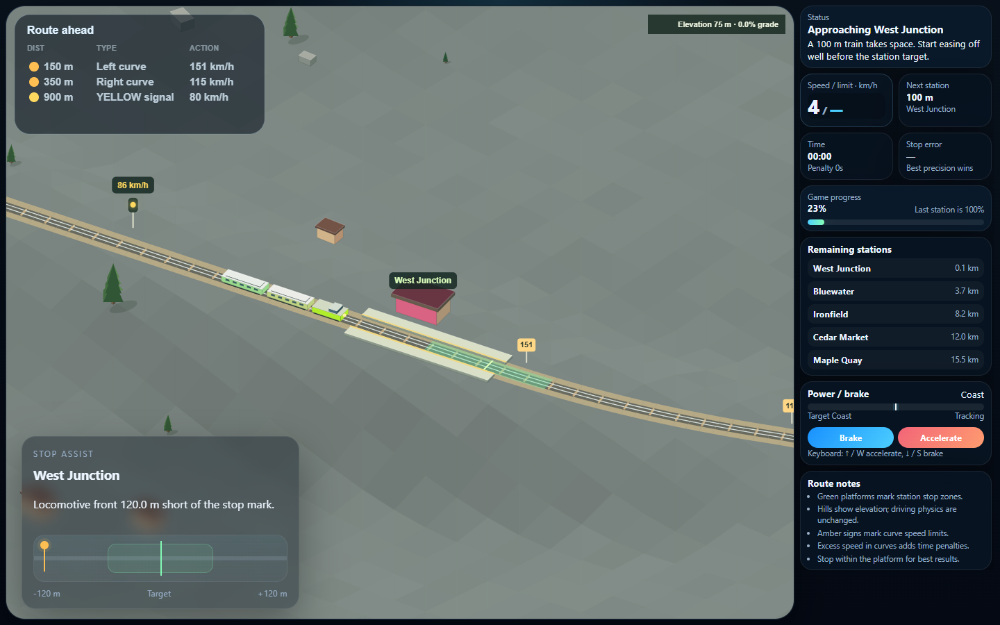

# Train Driver

A static browser-based train driving game built with plain HTML, CSS, Canvas 2D, and JavaScript.

The app renders terrain with **WebGL 2**, retaining Canvas 2D
for trains, scenery, and labels. It automatically falls back to Canvas terrain
when WebGL 2 is unavailable. Gameplay and audio are shared between renderers.

- `index.html?renderer=webgl2&seed=alpine`: WebGL terrain (the default)
- `index.html?renderer=canvas&seed=alpine`: the existing Canvas terrain

See [the experiment report](docs/webgl2-experiment.md) for scope, validation,
and controlled performance comparisons. The prototype is not a full 3D port.

Use `index.html?renderer=three&seed=alpine` for
the further Three.js world experiment. Track, stations, scenery, signals,
vehicles, and exhaust use retained GPU geometry on the same WebGL context as
the existing terrain. Text and HUD remain on Canvas/DOM. The existing local
Three.js r128 bundle loads only in this mode. See
[the Three.js comparison](docs/threejs-experiment.md) for measurements and tradeoffs.

You drive a 100 m consist across a procedurally generated route with stations, signals, curves, speed limits, isometric hills, elevated track, biome-driven scenery, and derailment penalties for major mistakes.

[Play it on GitHub Pages](https://szakeetm.github.io/trainDriver/)



## Tech Stack

- Plain `index.html`, `styles.css`, and browser-loaded scripts in `js/`
- Isometric Canvas terrain and train geometry; no WebGL required
- No build step, package manager setup, or backend

## Entry Points

- `index.html`: app shell, HUD, canvas, and script loading order
- `js/core.js`: DOM bindings, globals, and tuning constants
- `js/audio.js`: Web Audio setup and runtime updates
- `js/world.js`: seeded routes, track elevations, terrain, biomes, signals, and scenery
- `js/simulation.js`: controls, physics, stations, and failure handling
- `js/rendering.js`: heightfield shading, depth-sorted scenery/trains, and HUD overlays
- `js/terrain-webgl2.js`: experimental chunked GPU terrain, mode selection, and fallback
- `js/three-world.js`: optional retained Three.js world and shared-context handoff
- `js/main.js`: game bootstrap and frame loop
- `js/view.js`: isometric projection and camera

## Controls

- `ArrowUp`: increase power
- `ArrowDown`: increase braking
- On-screen buttons also support pointer/touch input

## Run Locally

Open `index.html` directly in a browser.

There is no install step and no build command.

If you want to run the Playwright autopilot tests, serve the repo over HTTP instead of opening the file directly:

```powershell
python -m http.server 4173
```

Append `?seed=alpine` (or any string) to replay the same landscape and route,
including on restarts. Without a seed, each run gets a fresh world. Train colors
and transient exhaust remain randomized.

Elevation and grade are shown on the map. Routes include climbs and descents
up to 8%: climbs need more power, and descents need earlier braking. Keep brakes
applied to hold the train on downhill track; uphill stalls stop without reversing.
Bridges, tunnels, and grade-separated crossings are outside this version's scope.

Gameplay tuning and shared globals start in [`js/core.js`](js/core.js).

Stations accept a stop within the configured tolerance (42.9 m by default).
Overrunning that window immediately targets the next station and adds a
60-second penalty. Overrunning the final station ends the run with delays.
A locomotive stopped exactly at a red signal can wait for clearance; crossing
the stop line while it is red ends the run.

Agent architecture and workflow context is in [`AGENTS.md`](AGENTS.md).
See [`docs/app-repairs.md`](docs/app-repairs.md) for current fixes, terrain
measurements, and validation. [`docs/code-review.md`](docs/code-review.md)
retains the historical review of the removed 3D renderer.

## Testing

Playwright covers route wins, isometric projection, elevation, terrain lifecycle,
offline loading, and desktop/mobile layouts.

Install the test dependencies:

```powershell
npm install
```

If Playwright asks for browser binaries on a fresh machine, install them with:

```powershell
npx playwright install
```

Start the local static server in one terminal:

```powershell
python -m http.server 4173
```

Then run one of these in a second terminal:

- `npx playwright test tests/isometric-terrain.spec.js tests/grade-physics.spec.js tests/rendering-optimizations.spec.js`: focused rendering regressions
- `npm run test:win`: fast headless win test
- `npm run test:win:watch`: headed visible autoplay demo
- `npm run test:win:headed`: headed watch mode using the reusable win spec

The visible modes drive the full route in a watchable browser window. The fast mode is intended for quick verification.

The driver requests power/braking and advances the production `update()` loop;
it does not teleport the train, overwrite its speed, or clear signals itself.
Win tests use fixed seeds and fail on the first unsuccessful run.

For a controlled comparison of the original and current terrain renderer:

```powershell
node tests/terrain-benchmark.js
```

The benchmark includes cold caches, stopped views, and moving cameras at
desktop DPR 1 and phone DPR 2. It measures CPU submission time, not hardware FPS.

Compare the current Canvas backend with the WebGL 2 prototype on Windows:

```powershell
node tests/webgl2-benchmark.js
```

This selects hardware Direct3D 11 in Chromium, records the actual GPU/backend,
and reports cold terrain, moving/stopped submission, full-frame submission,
animation pacing, GPU queries when available, and separate capture completion
diagnostics. Set `TRAIN_DRIVER_BROWSER=msedge` to use installed Edge instead.
Phone-sized results use the host GPU and are not physical-phone measurements.

Compare terrain-only WebGL 2 with the opt-in Three.js world:

```powershell
node tests/three-world-benchmark.js
```

The comparison uses the same seed/camera paths, hardware backend, and viewport
sizes. Warm submission, per-RAF costs, cold full-frame preparation, geometry
memory, and capture-completion diagnostics are reported separately.
